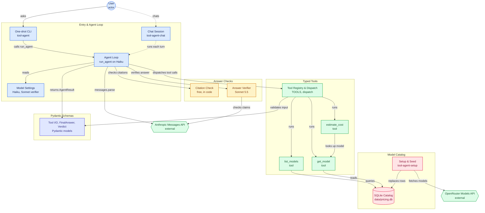

# Architecture

A user asks a question through the one-shot CLI (or, once built, a chat session that keeps the conversation). The agent loop runs on Claude Haiku: it gives the model the tool definitions, runs each tool call through the dispatcher, and feeds the results back until the model answers. Tools are typed: the dispatcher validates the model's input against a Pydantic model before running `list_models`, `get_model` or `estimate_cost`, which read a SQLite catalog. The setup and seed commands fill that catalog from OpenRouter's public model list (Anthropic, OpenAI and xAI models, with prices).

Every final answer goes through two checks before it's returned. The citation check (free, in code) confirms each cited tool call happened and that the chosen estimate matches its result. The verifier (Claude Sonnet) then checks the answer's claims against the cited results. A failed check sends feedback to the loop for another try; after two verifier rejections the answer is returned flagged, with the verifier's concerns.

Dashed edges are planned: the chat session is not written yet.

